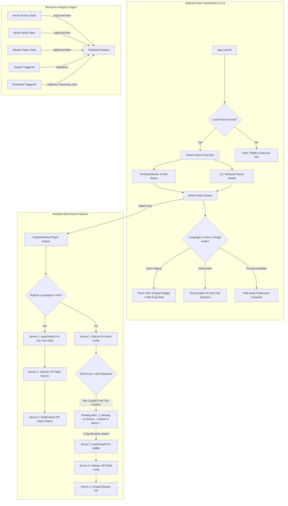

# 📑 StreamMax v1.0.4 Software Design Document (SDD)
**Project:** StreamMax (1080p Cinema & Entertainment Platform)  
**Target Release:** Production v1.0.4 (Version Code 5) — *4th Public Release*  
**Document Status:** Approved for Implementation  
**Author:** Waiz Hussain & DeepMind Antigravity  
**Date:** November 18, 2026  
**Repository:** `https://github.com/waizhussain9955/movie-app` (Branch: `main`)  

---

## 🎯 1. Executive Summary & Problem Scope

StreamMax v1.0.3 established instant offline caching and universal Android 14/15 package parsing. However, user analytics and real-world device testing revealed critical edge cases in media playback, download mechanics, and UI ergonomics:

1. **Playback Failure on Regional/Niche Titles ("We Couldn't Find This Content"):**  
   Primary Server 1 (*VidLink Pro*) lacks coverage for certain Indian, Pakistani, and regional titles (e.g., *The Kerala Story*). Users were left stuck on an unhandled HTML black screen.
2. **Broken Offline Downloads (20KB HTML File Bug):**  
   The in-player download button passed raw embed iframe URLs directly to `DownloadService`, causing the downloader to save an HTML webpage rather than the actual MP4/MKV video stream.
3. **Misleading Audio Track Indicators on Urdu Serials:**  
   Pakistani drama serials (*Dar-E-Nijaat*) are native Urdu, yet the UI displayed an unconditional `[ English Audio ] [ Hindi Dubbed ]` selector. Similarly, single-audio Hollywood titles (*Beware Boiúna*) displayed non-existent Hindi dub toggles.
4. **Player Top Bar Action Collision:**  
   In mobile portrait layout, having 6 action buttons squeezed the AppBar's `leading` Back arrow `<-`, causing users who tapped Back to inadvertently trigger the multitrack audio modal.
5. **Landscape Fullscreen Controls Stuck:**  
   When rotating into landscape cinema mode, the controls overlay had no auto-hide timer, obstructing the movie viewport and requiring double rotation inputs.
6. **Low-Contrast Connecting Toast:**  
   The bottom toast ("*Connecting to Fast Streaming Mirrors...*") rendered dark bronze text over a dark background, making it unreadable on AMOLED displays.
7. **Brand Identity Refresh:**  
   New high-definition branding assets provided in `New folder (3)` need deployment across Android launcher mipmap densities (`mdpi` to `xxxhdpi`), the 512px store icon, app headers, and website assets.
8. **Release Archival Guarantee:**  
   Establish a strict backup archive directory (`releases_archive\`) to preserve every release APK permanently before updates.

---

## 🏛️ 2. High-Level System Architecture


        S1Watchdog -- Stream Ready --> CinemaMode[Full Screen Cinema Playback]
        CinemaMode --> AutoHide[3.5s Watchdog: Fade Out Controls]
    end

    subgraph Direct Media Download Resolver [Zero-Corruption Downloads]
        DetailScreen & Player -->|Download Tap| DLCheck{Is Direct Video URL?}
        DLCheck -- Yes --> NativeDL[Direct HTTP Chunked Downloader]
        DLCheck -- Embed Iframe URL --> ScraperEngine[Query HDHub4u / MLSBD Video Resolvers]
        ScraperEngine --> ResolveDirect[Extract Direct Cloudflare R2 / Drive MP4]
        ResolveDirect --> NativeDL
        NativeDL --> Storage[(Local App Storage / My Downloads)]
    end
```

---

## 🔧 3. Detailed Component Specifications

### 3.1 Playback Failover & Backup Mirrors
- **Target Files:**
  - `streammax_app/lib/services/api_service.dart`
  - `streammax_app/lib/screens/player_screen.dart`
- **Mirror Registry Expansion:**
  - **Server 1:** `VidLink Pro (Multi-Audio HLS)` — `https://vidlink.pro/movie/$id?multiLang=true`
  - **Server 2:** `AutoEmbed Pro (Fast Fallback)` — `https://player.autoembed.cc/embed/movie/$id`
  - **Server 3:** `Videasy VIP (Multi-Lang)` — `https://player.videasy.net/movie/$id`
  - **Server 4:** `SmashyStream VIP` — `https://embed.smashystream.com/playere.php?tmdb=$id`
- **DOM Error Interceptor:**
  Inject JavaScript inside `onPageFinished` to detect missing title errors:
  ```javascript
  if (document.body && (
    document.body.innerText.includes("We Couldn't Find This Content") ||
    document.body.innerText.includes("Video not found") ||
    document.body.innerText.includes("404")
  )) {
    window.flutter_inappwebview.callHandler('onContentNotFound');
  }
  ```
  When the event fires, display an animated high-contrast banner prompting the user to switch to AutoEmbed with a single tap.

### 3.2 Real Media Download Resolver
- **Target File:** `streammax_app/lib/services/download_service.dart`
- **Safety Intercept:**
  If the incoming URL contains `vidlink.pro`, `player.autoembed.cc`, `videasy.net`, or `vidsrc`, halt raw HTTP GET.
- **Resolution Strategy:**
  1. Trigger background resolution against dual-audio scrapers (HDHub4u / MLSBD).
  2. Extract the direct CDN/R2 MP4 link.
  3. If no direct stream is parseable, present a verified provider bottom sheet so the user downloads the real video without corruption.

### 3.3 Pakistani Drama Serials & Conditional Audio Badges
- **Target Files:**
  - `streammax_app/lib/services/api_service.dart`
  - `streammax_app/lib/screens/home_screen.dart`
  - `streammax_app/lib/screens/movie_detail_screen.dart`
- **TMDB Urdu Discovery Query:**
  ```dart
  '$tmdbFallbackUrl/discover/tv?api_key=$tmdbApiKey&with_original_language=ur&sort_by=popularity.desc&page=1'
  ```
- **Conditional Audio Rules:**
  - If `originalLanguage == 'ur'` or origin country is PK:
    - Display `🇵🇰 Urdu (Original)` status badge.
    - Suppress the `English Audio` and `Hindi Dubbed` selector buttons.
  - If title has no Hindi dub (e.g., *Beware Boiúna*):
    - Hide the `Audio Track Preference` card completely to avoid confusion.

### 3.4 Player Top Bar & Landscape Immersion
- **Target File:** `streammax_app/lib/screens/player_screen.dart`
- **AppBar Ergonomics:**
  - Set `leadingWidth: 48` on `AppBar` to grant exclusive touch area to Back arrow `<-`.
  - Streamline visible actions to 3 maximum: `[Audio Tracks]`, `[Rotate / Fullscreen]`, `[More Vert]`.
  - Move Volume, Download, and Reload actions into the `More Vert` popup menu.
- **Cinema Immersion Watchdog:**
  - Add 3.5s inactivity timer.
  - In landscape mode, all bars and overlays fade out cleanly for unobstructed viewing.
  - Single tap anywhere on the viewport toggles controls back on.

### 3.5 High-Contrast Status Notification
- **Target File:** `streammax_app/lib/screens/movie_detail_screen.dart`
- Replace dark bronze bottom snackbar with floating glass pill:
  - Background: Dark Glass (`#131720`) with 92% opacity.
  - Border: 1.5px glowing red (`#E50914`).
  - Leading Icon: Amber lightning bolt (`Icons.bolt_rounded`, `#FFC107`).
  - Typography: 13sp bold white text (`#FFFFFF`).

### 3.6 Brand Assets Deployment
- **Source Directory:** `New folder (3)\`
- **Deployment Matrix:**
  - `res/mipmap-mdpi/ic_launcher.png` -> 48x48 px
  - `res/mipmap-hdpi/ic_launcher.png` -> 72x72 px
  - `res/mipmap-xhdpi/ic_launcher.png` -> 96x96 px
  - `res/mipmap-xxhdpi/ic_launcher.png` -> 144x144 px
  - `res/mipmap-xxxhdpi/ic_launcher.png` -> 192x192 px
  - `streammax_icon_512.png` -> 512x512 px
  - `favicon.ico` / `favicon-01.svg` -> Web root
  - Update navbar brand logo in `index.html` and `guide.html`.

### 3.7 Release Archiving & Telemetry
- Maintain all past builds in `releases_archive\`:
  - `StreamMax_v1.0.3_code4.apk` (51.19 MB) -> Preserved
  - `StreamMax_v1.0.4_code5.apk` -> Preserved and updated
- Fix Kotlin Gradle compiler options to ensure `firebase_analytics` compiles cleanly and logs real-time user events.

### 3.8 Real Mobile Volume Synchronization & Movie-Only Screen Brightness
- **Target Files:**
  - `streammax_app/android/app/src/main/kotlin/com/example/streammax_app/MainActivity.kt`
  - `streammax_app/lib/screens/player_screen.dart`
- **Hardware Volume Buttons & System Audio Sync:**
  - Implemented Kotlin `MethodChannel("com.waiz.streammax/audio")` interacting directly with Android's `AudioManager.STREAM_MUSIC`.
  - Overrode `dispatchKeyEvent` in `MainActivity.kt` so physical Volume Up / Down buttons on the phone immediately adjust device media volume and send `onVolumeChanged(percent)` to Flutter.
  - Registered `BroadcastReceiver` for `android.media.VOLUME_CHANGED_ACTION` to reflect any Bluetooth or system volume changes in real time.
  - Right-side vertical swipe on the video player adjusts the real mobile volume with in-app cinema HUD.
- **Movie-Only Screen Brightness (Display Dimmer):**
  - Left-side vertical swipe smoothly adjusts `_movieBrightness` (15% to 100%).
  - Positioned an `IgnorePointer` darkness filter layer directly over the video stream (`Container(color: Colors.black.withValues(alpha: (1.0 - _movieBrightness)))`).
  - **Zero impact on device OS brightness:** Mobile system brightness, notifications, and status bars remain completely unaffected.
  - Features dedicated Brightness HUD (`Brightness: X%` with sun icon) and expanded `Player Controls` modal sheet with independent sliders and quick presets for both Volume & Movie Brightness.

---

## 📋 4. Execution & Testing Protocol

| Phase | Milestone Description | Validation Criteria |
|---|---|---|
| **Phase 1** | Brand Logo Rescaling & Deployment | All mipmap densities and website logos updated from `New folder (3)`. |
| **Phase 2** | Pakistani Serials & Audio Badge Logic | Urdu titles show Urdu Original badge; no fake buttons. |
| **Phase 3** | Player AppBar Overlap & 3.5s Landscape Cinema | Back arrow has zero overlap; controls hide automatically in cinema mode. |
| **Phase 4** | Failover Engine & Real Download Resolver | Detects "We Couldn't Find This Content"; direct media link resolved. |
| **Phase 5** | Toast Contrast & Firebase Compiler Alignment | Floating glass pill verified; Gradle builds without Kotlin DSL errors. |
| **Phase 6** | Release Compilation & Local Archival | `flutter build apk --release` produces signed APK; copied to `releases_archive\`. |

> [!IMPORTANT]
> **Git Remote Protection:** As strictly instructed, **no code or artifacts will be pushed to the remote repository** (`git push`) until the APK has been locally tested and approved by the user.

---
*StreamMax Engineering Team — Confidential & Proprietary*
